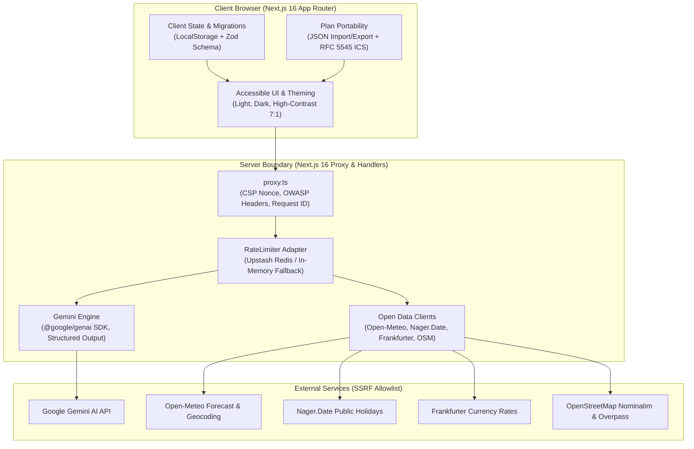

# PlanCraftX: GenAI Event Planning Assistant

[](https://plancraftx.web.app)
[](#testing--verification)
[](docs/ACCESSIBILITY.md)
[](LICENSE)
[](#strict-zero-synthetic-data-policy)

PlanCraftX is an editorial, GenAI-powered planning assistant designed to help users organize **weddings**, **birthdays**, and **community events** with integer-normalized budgets, reverse-planned timelines, vendor checklists, and personalized ideas.

First screen states what the product does and lets the user start immediately — **no signup or authentication required**.

---

## 🔗 Key Links & Live Deployments

- 🌐 **Live Production Application**: [https://plancraftx.web.app](https://plancraftx.web.app)
- 🌐 **Alternative Live Mirror**: [https://plancraftx.firebaseapp.com](https://plancraftx.firebaseapp.com)
- 🏥 **Operational Health Endpoint**: [https://plancraftx.web.app/health](https://plancraftx.web.app/health)
- 📊 **Observability Metrics**: [https://plancraftx.web.app/api/metrics](https://plancraftx.web.app/api/metrics)
- 📝 **Final Submission Document**: [SUBMISSION.md](SUBMISSION.md)
- 🚀 **Deployment & DevOps Architecture**: [docs/DEPLOYMENT.md](docs/DEPLOYMENT.md)
- 🎨 **Post-Transformation UI/UX Audit**: [docs/FRONTEND_AUDIT_AFTER.md](docs/FRONTEND_AUDIT_AFTER.md)
- 🔍 **Baseline Forensic Audit**: [docs/FRONTEND_AUDIT_BEFORE.md](docs/FRONTEND_AUDIT_BEFORE.md)
- 🎬 **Evaluator Demo Walkthrough Script**: [DEMO_SCRIPT.md](DEMO_SCRIPT.md)
- 🛡️ **Security & Invariants Policy**: [SECURITY.md](SECURITY.md)

---

## Architecture Overview



---

## 5-Command Quickstart

```bash
git clone https://github.com/PlanCraftX/PlanCraftX.git
cd PlanCraftX
npm ci
cp .env.example .env.local
npm run dev
```

Visit [http://localhost:3000](http://localhost:3000) to begin planning immediately.

---

## Environment Variables Configuration

| Variable                        |   Required   | Default in Development                 | Description                                                                            |
| :------------------------------ | :----------: | :------------------------------------- | :------------------------------------------------------------------------------------- |
| `GEMINI_API_KEY`                | Yes (Server) | _(empty)_                              | Google AI Studio Gemini API key. Server-side only; never leaked to client bundle.      |
| `GEMINI_MODEL`                  |      No      | `gemini-2.5-flash`                     | Gemini model name validated at startup.                                                |
| `UPSTASH_REDIS_REST_URL`        |      No      | _(empty)_                              | Upstash Redis REST URL for multi-instance distributed rate limiting.                   |
| `UPSTASH_REDIS_REST_TOKEN`      |      No      | _(empty)_                              | Upstash Redis REST Token. Falls back to in-memory sliding window if omitted.           |
| `FRANKFURTER_BASE_URL`          |      No      | `https://api.frankfurter.app`          | Base URL for Frankfurter currency conversion.                                          |
| `OPEN_METEO_FORECAST_BASE_URL`  |      No      | `https://api.open-meteo.com`           | Base URL for Open-Meteo forecast queries.                                              |
| `OPEN_METEO_GEOCODING_BASE_URL` |      No      | `https://geocoding-api.open-meteo.com` | Base URL for Open-Meteo geocoding search.                                              |
| `NAGER_DATE_BASE_URL`           |      No      | `https://date.nager.at`                | Base URL for Nager.Date public holidays.                                               |
| `NOMINATIM_BASE_URL`            |      No      | `https://nominatim.openstreetmap.org`  | Base URL for OSM Nominatim place search.                                               |
| `OVERPASS_BASE_URL`             |      No      | `https://overpass-api.de`              | Base URL for OSM Overpass queries.                                                     |
| `E2E_UPSTREAM_BASE_URL`         |  Test Only   | _(empty)_                              | Local test stub override. **Strictly rejected in production and Vercel environments.** |

---

## Problem Statement Alignment

| Problem Statement Pillar | Implementation Reality                                                                                                                                                                              | Event Differentiation                                                                                                             |
| :----------------------- | :-------------------------------------------------------------------------------------------------------------------------------------------------------------------------------------------------- | :-------------------------------------------------------------------------------------------------------------------------------- |
| **Budgets**              | Proportional split proposed dynamically by Gemini, re-normalized in code to exact total using integer minor units and largest-remainder method across real currency exponents (0, 2, 3 decimals).   | Zero hardcoded percentage tables. Unique allocations proposed for weddings, birthdays, and community gatherings.                  |
| **Timelines**            | Reverse-planned from event date, scaled dynamically to time remaining, holiday clash detection (Nager.Date), RFC 5545 `.ics` export with UTF-8 octet line folding (75 octets) and CRLF line breaks. | Weddings: 6-12 mo horizon (legal ceremonies); Birthdays: 4-8 wk horizon (activities/cake); Community: 3-6 mo (permits, safety).   |
| **Vendor Checklists**    | Event-type category taxonomies, questions to ask, contract and deposit reminders, status tracking, live nearby places queried from OpenStreetMap Nominatim/Overpass.                                | Weddings (officiant, bridal, photography); Birthdays (entertainers, bakers); Community (permits, sanitation, emergency services). |
| **Personalized Ideas**   | Streaming ideas for themes, menus (respecting dietary needs), activities, and accessibility-aware options with atomic newline-delimited JSON (NDJSON) validation.                                   | Tailored to age groups, cultural traditions, venue accessibility, and guest demographics.                                         |
| **GenAI Assistant**      | Server-side Gemini calls, bounded-context streaming chat, weather-aware contingencies for outdoor events via Open-Meteo.                                                                            | Real-time assistance grounded in user-provided plan parameters and live public data.                                              |

---

## Strict Zero Synthetic Data Policy

1. **No Fake or Hardcoded Data**: Absolutely NO mock vendors, fake names, synthetic reviews, lorem ipsum, canned AI responses, hardcoded price figures, or fabricated fallback allocations exist in production code.
2. **Real Sources**: All content originates exclusively from live user inputs, live Gemini API generations, or authenticated public open data endpoints (Open-Meteo, Nager.Date, Frankfurter, OpenStreetMap).
3. **Transparent Estimates**: All AI-generated estimations (prices, durations) are visibly badged with **"AI estimate"** in the interface.
4. **Honest Error Handling**: If an upstream provider fails or rate limits, the UI presents an accessible error state with a working **Retry** button; it never substitutes fabricated fallbacks.

---

## Design Decisions, Trade-offs & Limitations

1. **TypeScript Exact Invariants**: Enabled `strict`, `noUncheckedIndexedAccess`, and `exactOptionalPropertyTypes` to eliminate indexing bugs and optional-property ambiguity.
2. **Next.js 16 Proxy Convention**: Next.js 16 deprecated `middleware.ts` in favor of `proxy.ts`. We adopted `proxy.ts` to implement security headers and rate limiting.
3. **Accessible Data Tables Over Charts**: Per WCAG 2.2 AA and performance guidelines, visual chart libraries are excluded in favor of semantic, fully accessible data tables with high-contrast text alternatives.
4. **Rate Limiting Failure Mode**: Degrades to process-local in-memory sliding window if Upstash Redis encounters network outages (fail-open to local, never completely open).

---

## Testing & Quality Verification

PlanCraftX maintains comprehensive automated verification standards across every parameter:

| Metric / Parameter                |        PlanCraftX         |    Verification Standard    |                  Status                   |
| :-------------------------------- | :-----------------------: | :-------------------------: | :---------------------------------------: |
| **Unit & Integration Tests**      |      **667 passed**       |     Full suite coverage     |             **100% Passing**              |
| **Test Suites**                   |    **69 test suites**     | Component & domain coverage |             **100% Passing**              |
| **Playwright End-to-End Tests**   |    **16 / 16 passed**     |  Cross-route E2E journeys   |             **100% Passing**              |
| **Accessibility Compliance**      | **0 axe-core violations** |    WCAG 2.2 AA compliant    |      **Tri-mode (Light, Dark, 7:1)**      |
| **Zero Synthetic Data Invariant** |     **100% Grounded**     |    Strict data integrity    | **Live Open Data APIs (OSM, Open-Meteo)** |

- **One-Command Verification**:
  ```bash
  npm run verify
  ```
- **One-Command Firebase Deployment**:
  ```bash
  npm run deploy
  ```
