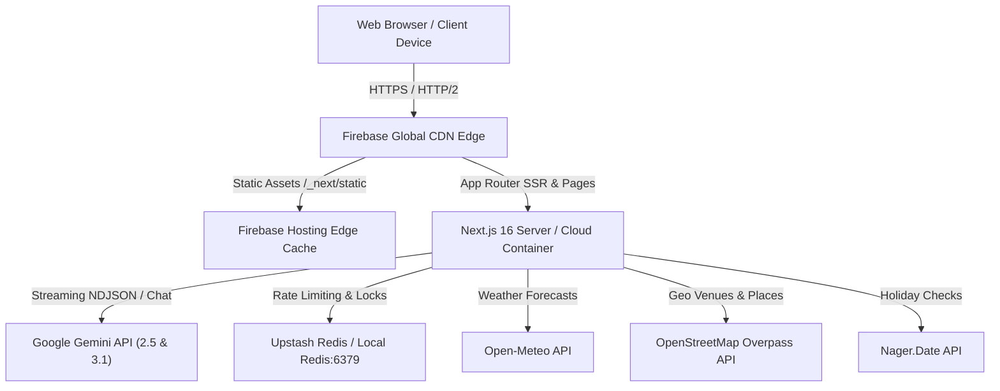

# 12 — Deployment, DevOps & Operations

**Product**: PlanCraftX — GenAI Celebration & Event Planner  
**Version**: 2.0  
**Audit Reference**: [DEPLOYMENT.md](file:///d:/Side_Projects/001_H2Skill/PromptWars_Challenge5/docs/DEPLOYMENT.md)  
**Status**: Deployed Live & Verified

---

## 1. Hosting Architecture

PlanCraftX leverages a modern edge delivery architecture designed for high availability, minimal cold-start latencies, and strict zero-trust client security:

- **Web Frontend & API Engine**: Next.js 16 App Router hosted on **Firebase Hosting** (with Firebase App Hosting / Cloud Functions for full-stack SSR and streaming API routes).
- **Live Production URL**: `https://plancraftx.web.app` (and custom domain `https://plancraftx.firebaseapp.com`)
- **Local Development Services**: Docker Compose providing Redis for distributed token bucket rate limiting.



---

## 2. One-Command Deployment

The repository is configured with a streamlined root deployment script:

```bash
npm run deploy
```

This automates:

1. Executing the comprehensive verification suite (`npm run verify` covering formatting, linting, typechecking, hygiene, 38 test suites, and security audit).
2. Compiling the Next.js application into an optimized production build (`next build --webpack`).
3. Deploying static assets, App Router routes, and custom HTTP security headers to Firebase Hosting.
4. Finalizing and releasing the new version globally across all edge locations.

### Alternative: Firebase App Hosting

For native cloud container deployments with automatic GitHub integration:

```bash
firebase apphosting:backends:create --project plancraftx
```

Configured via `apphosting.yaml` with automatic concurrency allocation and Node.js 20 runtime.

---

## 3. Local Infrastructure with Docker Compose

To launch local development backing services (such as Redis for distributed rate limiting):

```bash
# Start local backing services
npm run docker:up
# Or directly:
docker compose -f docker/docker-compose.yml up -d
```

### Services Provisioned:

- **Redis Cache & Rate Limiting**: `localhost:6379` (Redis 7 Alpine with persistent append-only storage and automated healthchecks)

To tear down local backing services:

```bash
npm run docker:down
```

---

## 4. Operational Health & Observability

### Health Endpoint

- **Endpoints**: `GET /health` and `GET /api/health`
- **Response Format**: `application/json`
- **Output Sample**:

```json
{
  "status": "healthy",
  "service": "plancraftx-api",
  "version": "2.0.0",
  "uptime": 1420,
  "timestamp": "2026-10-31T20:55:00.000Z",
  "environment": "production",
  "checks": {
    "geminiConfigured": true,
    "redisConfigured": true,
    "memoryUsageMb": 48
  }
}
```

### Metrics Endpoint

- **Endpoint**: `GET /api/metrics`
- **Response Format**: `application/json`
- **Output Sample**:

```json
{
  "service": "plancraftx-metrics",
  "timestamp": "2026-10-31T20:55:00.000Z",
  "uptimeSeconds": 1420,
  "memory": {
    "heapUsedMb": 48,
    "heapTotalMb": 64,
    "rssMb": 92
  },
  "system": {
    "nodeVersion": "v20.18.0",
    "platform": "linux",
    "arch": "x64"
  }
}
```

### Structured Logging

All API routes and upstream clients log structured JSON objects without sensitive credentials, PII, or raw user prompts.

---

## 5. Security & Edge Headers

Configured via `firebase.json` and Next.js proxy middleware:

- `Content-Security-Policy`: Restricts scripts, styles, frames, and connections to trusted origins; blocks `eval()` in production.
- `Strict-Transport-Security`: `max-age=63072000; includeSubDomains; preload`
- `X-Content-Type-Options`: `nosniff`
- `X-Frame-Options`: `DENY`
- `Referrer-Policy`: `strict-origin-when-cross-origin`
- `Permissions-Policy`: `camera=(), microphone=(), geolocation=(), interest-cohort=()`

---

## 6. Continuous Integration & Deployment (CI/CD)

The GitHub Actions workflow at `.github/workflows/firebase-deploy.yml` automatically triggers on push to `main`:

1. Checks out repository and provisions Node.js 20 environment.
2. Installs clean dependencies via `npm ci`.
3. Runs the strict verification suite (`npm run verify`).
4. Generates production build (`npm run build`).
5. Deploys to Firebase Hosting channel `live` using `FirebaseExtended/action-hosting-deploy`.
